# sb_zmx_viewer - coming soon - Nov/Dec 2026

**View and check Zemax OpticStudio lens designs without an OpticStudio licence.**

sb_zmx_viewer opens sequential `.zmx` and `.zar` lens files and shows the complete prescription, a ray-traced layout
and the analyses that come up most when a design is reviewed or built: diffraction MTF, RMS wavefront, relative
illumination, field curvature and distortion, OPD fans, chromatic focal shift, image simulation on a camera sensor, a
tolerance sensitivity table, the best surface for a filter coating, and best focus.

It is a viewer, not a design program: it never changes your files. Its numbers have been checked against OpticStudio,
ray by ray and analysis by analysis, on several hundred real lens designs.

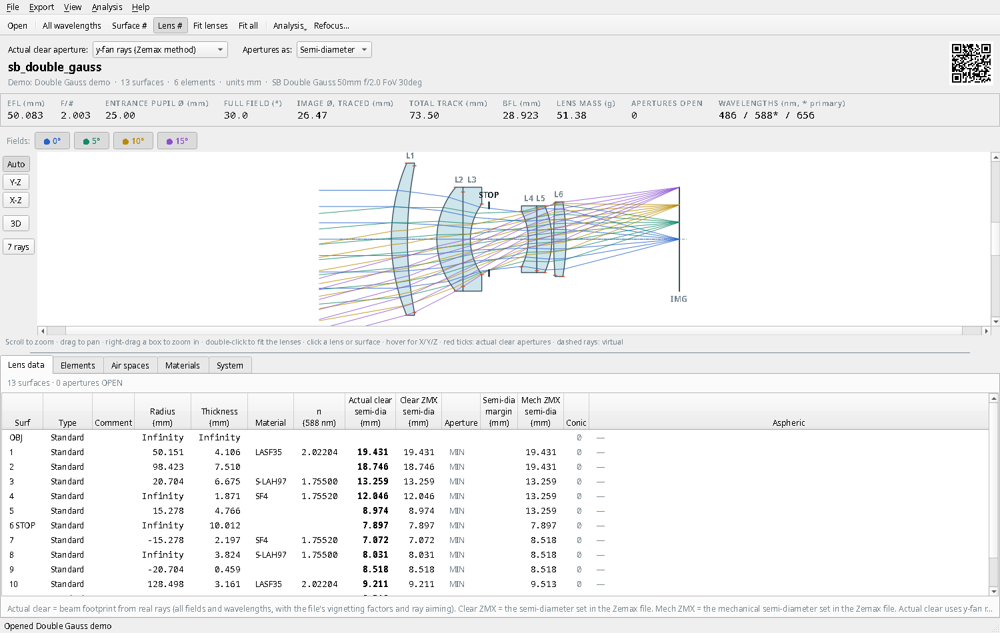

---

## Contents

1. [Download](#download)
2. [Quick start](#quick-start)
3. [The main window](#the-main-window)
4. [Analyses](#analyses)
5. [Glass catalogs](#glass-catalogs)
6. [What it reads](#what-it-reads)
7. [Command line (Linux)](#command-line-linux)
8. [Limitations](#limitations)
9. [Support and terms](#support-and-terms)

---

## Download

Download the program for your system from the **[latest release](../../releases/latest)**:

| Platform | File | Notes |
|---|---|---|
| Windows 10 / 11 (64-bit) | [`sb_zmx_viewer-windows-x64.exe`](../../releases/latest/download/sb_zmx_viewer-windows-x64.exe) | one file, nothing to install |
| Linux (x86-64) | [`sb_zmx_viewer-linux-x86_64`](../../releases/latest/download/sb_zmx_viewer-linux-x86_64) | one file, nothing to install; built on a current distribution |

Each program is self-contained: glass catalogs, a demo design and everything else it needs are inside it. No Python,
no OpticStudio and no internet connection are needed. This guide is also available as a [PDF](README.pdf).

---

## Quick start

1. **Download** the file for your system.
2. **Run it.**
   - **Windows:** double-click `sb_zmx_viewer-windows-x64.exe`. The program isn't code-signed, so Windows SmartScreen may
     warn you the first time: click **More info ▸ Run anyway**. The first start takes a few seconds while it unpacks.
   - **Linux:** make it executable and start it:
     ```
     chmod +x sb_zmx_viewer-linux-x86_64
     ./sb_zmx_viewer-linux-x86_64
     ```
3. **Try the demo:** **File ▸ Open demo ▸ Double Gauss demo** opens a 6-element 50 mm F/2 Double Gauss that ships
   with the program.
4. **Open your own design:** drag a `.zmx` or `.zar` file onto the window, or use **File ▸ Open** (Ctrl+O). On Linux
   you can also give it on the command line: `./sb_zmx_viewer-linux-x86_64 mylens.zmx`. A large design shows its
   progress while it opens (**Cancel** keeps the design you had).
5. **Run an analysis** from the **Analysis** menu (or the Analysis drop-down on the toolbar). Each one opens in its own
   window and follows whatever design is loaded.

---

## The main window

- **Header:** the design's name and title, then the key numbers: EFL, F/#, entrance pupil, field, image size, total
  track, back focal length, lens mass and wavelengths.
- **Notes bar:** under the header, a one-line summary of anything worth knowing about the file (a missing glass, a
  surface type that can't be modelled, a field the lens can't reach). Hover over it to read the notes in full.
- **Layout:** the lens section with real rays for every field.
- **Tables:** under the layout, with a divider you can drag.

### Layout

| Action | How |
|---|---|
| Zoom | mouse wheel, Ctrl+= / Ctrl+- |
| Pan | drag |
| Zoom to a box | right-drag |
| Fit the lenses / fit everything | double-click, or **View ▸ Fit lenses** (F) / **Fit all** (Shift+F) |
| Details of a lens, surface or air space | click it (**View ▸ Inspector**, Ctrl+I, lists everything about it) |
| Plane drawn | the **Auto**, **Y-Z**, **X-Z** buttons on the left |
| Rays per field | the **5 / 7 / 0 / 3 rays** button on the left (0: no rays) |
| Labels | **View ▸ Surface #** and **Lens #** |

Red ticks mark the ray-traced clear apertures. Dashed rays are virtual. Mirrors, fold mirrors, prisms, central
obscurations and spiders are drawn as they are.

### Selecting a lens or an air space

Click a lens, a surface or the gap between two lenses. It's highlighted on the drawing, with its edge thickness drawn
and labelled at the height where it's measured. The **Inspector** (View ▸ Inspector) lists its centre and edge
thicknesses, apertures and sags, and its row is selected in the tables. The **Air spaces** tab gives every gap's
centre and edge thickness: the numbers needed to design spacers and retainers.

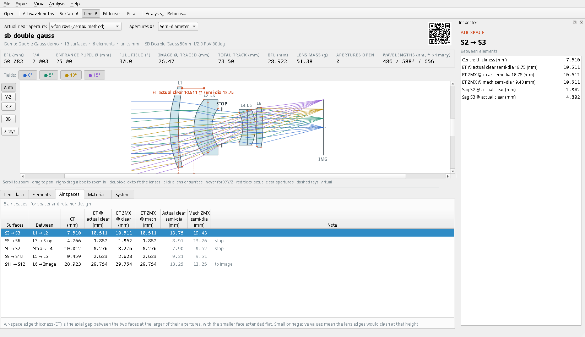

A lens selected shows its centre and edge thicknesses on the drawing. The Inspector gives its faces, clear and
mechanical apertures, material, volume and mass; the **Elements** tab lists the same for every lens.

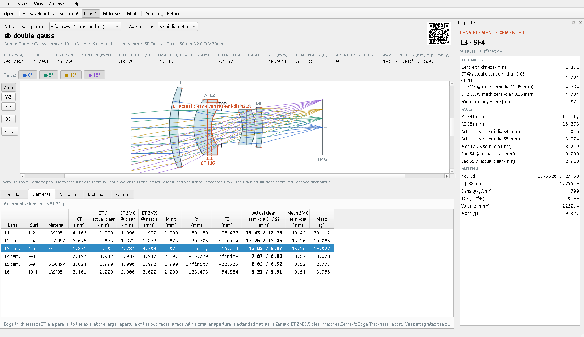

**3D layout** (**View ▸ 3D layout…**, Ctrl+3, or the **3D** button): shaded, see-through lens solids with rays traced
in 3D. Drag to rotate (about whatever is in the middle of the view, as in a CAD program), wheel to zoom about the
cursor, right-drag to pan, double-click to fit.

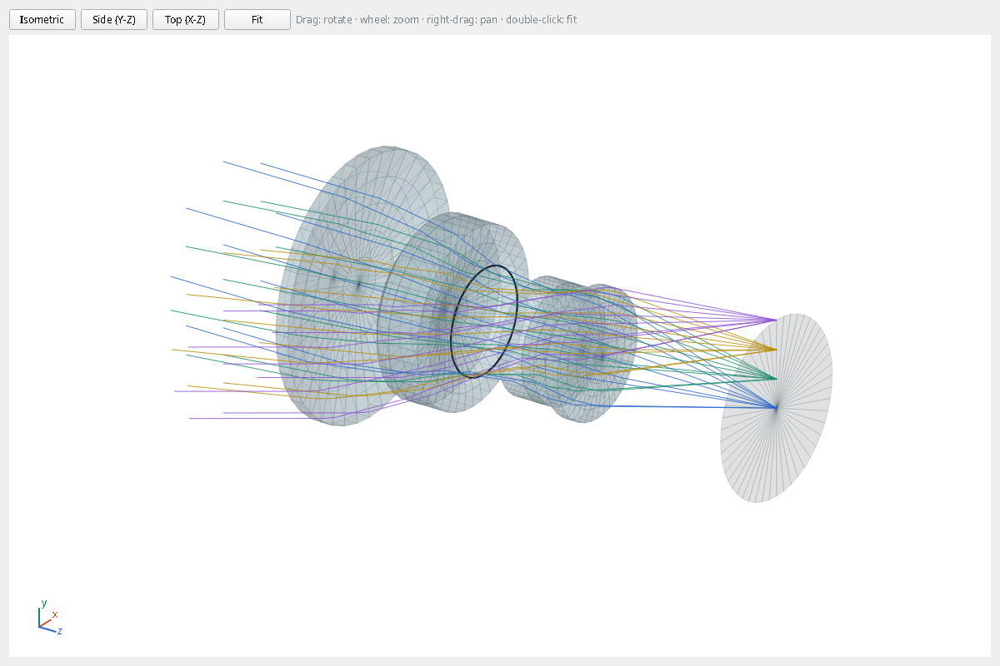

### Tables

| Tab | Contents |
|---|---|
| **Lens data** | one row per surface: radius, thickness, material, index, conic, aspheric terms, clear and mechanical apertures |
| **Elements** | one row per lens: centre and edge thicknesses, diameters, volume and mass |
| **Air spaces** | one row per air gap: centre and edge thicknesses |
| **Materials** | every glass used: catalog, nd, Vd, density, index at each wavelength |
| **System** | EFL, F/#, working F/#, NA, pupils, track, BFL, ray aiming, fields, wavelengths |

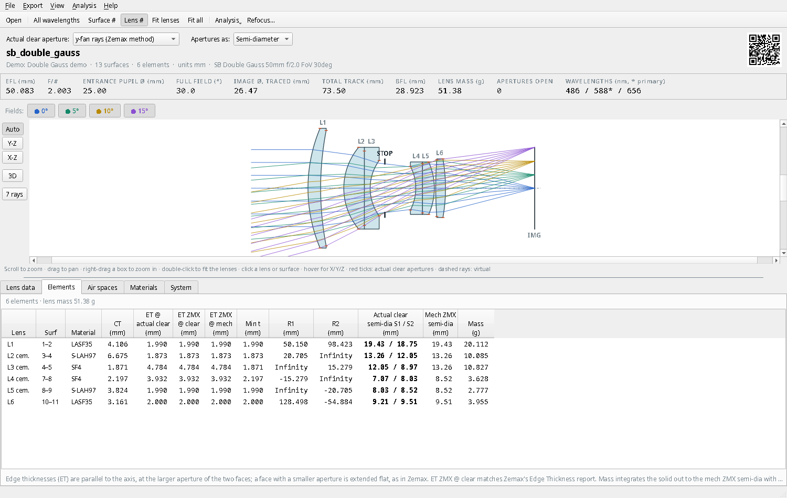

Columns marked **ZMX** come straight from the file; the others are worked out by the viewer. **Actual clear
semi-dia** is the ray-traced beam footprint on each surface (all fields and wavelengths). **Aperture** says **OPEN**
where the file's semi-diameter is larger than the beam needs. **Apertures as** switches between semi-diameters and
diameters.

### Editing the lens data

Double-click a radius, thickness, material, aperture or conic in **Lens data**, type a new value and press Enter, for
example to see how a lens built to its measured values performs. The layout, tables and every analysis follow at once;
edited values are shown bold, and **File ▸ Revert lens edits** puts them all back. Edits last for the session only.
The file on disk is never changed.

### Zooms and other multi-configuration designs

A **Configuration** box appears next to the aperture options; **Ctrl+PgUp / Ctrl+PgDn** step through the
configurations. Everything follows the configuration shown, and a **Configurations** tab lists the key numbers and
every moving thickness for all of them.

### Exports

**Export ▸ DXF** (lens cross-section for CAD), **SVG** and **PNG** (the layout), **CSV** (the current table or all
tables). Every analysis window also has **Export CSV…** and **Save image…**.

---

## Analyses

Each analysis calculates when its window opens, and again whenever the design changes (a new file, another
configuration, a refocus, a lens edit). After you change one of its own settings, press **Update** (it turns to the
accent colour), double-click the plot, or press Enter in a number box.

### MTF (Ctrl+M)

Polychromatic or single-wavelength diffraction MTF (FFT), tangential and sagittal, for every field, with the
diffraction limit. The line under the plot gives the RMS wavefront error per field. Hover for values.

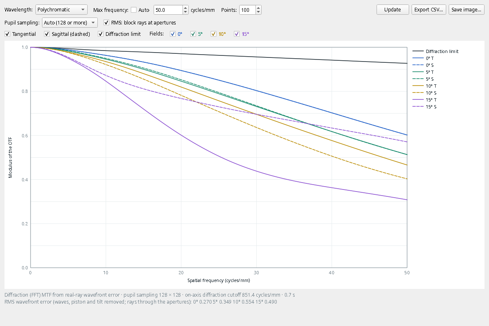

### Through-focus MTF (Ctrl+Shift+M)

MTF at one frequency against focus for every field, with a table of each field's peak.

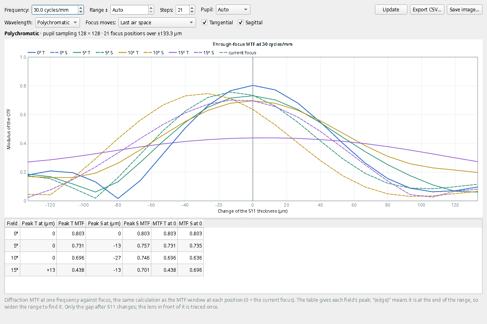

### Relative illumination (Ctrl+R)

Illumination across the field relative to its brightest point, including cos⁴-type fall-off, pupil aberrations and
vignetting, with a cos⁴ reference curve. Vignetting can follow the file's vignetting factors, its surface apertures,
or the glass edges only.

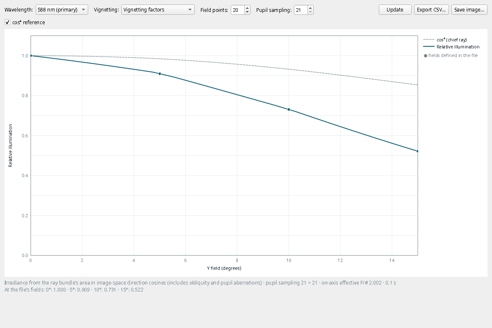

### Field curvature and distortion (Ctrl+D)

Tangential and sagittal focus shift and F-Tan(θ) or F-θ distortion against field, for every wavelength, with the full
table underneath.

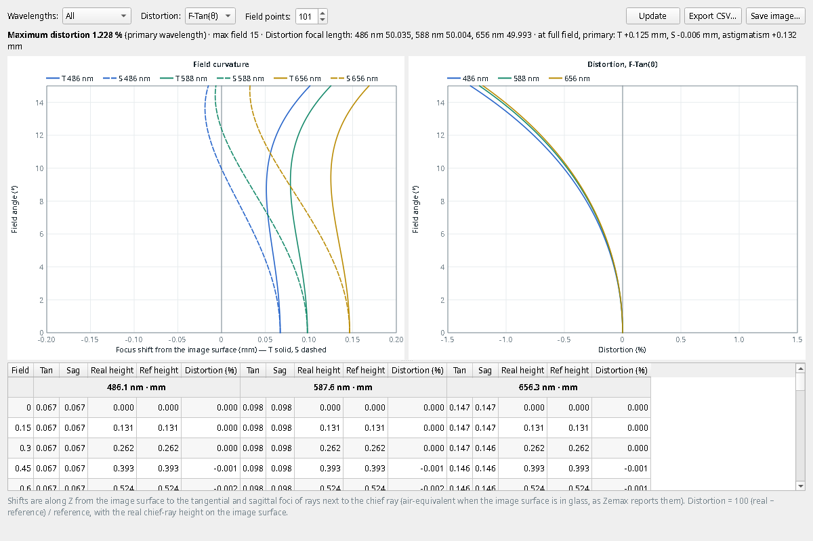

### OPD fan (Ctrl+E)

Optical path difference across the pupil, tangential and sagittal, for every field and wavelength, laid out compactly
on one common scale.

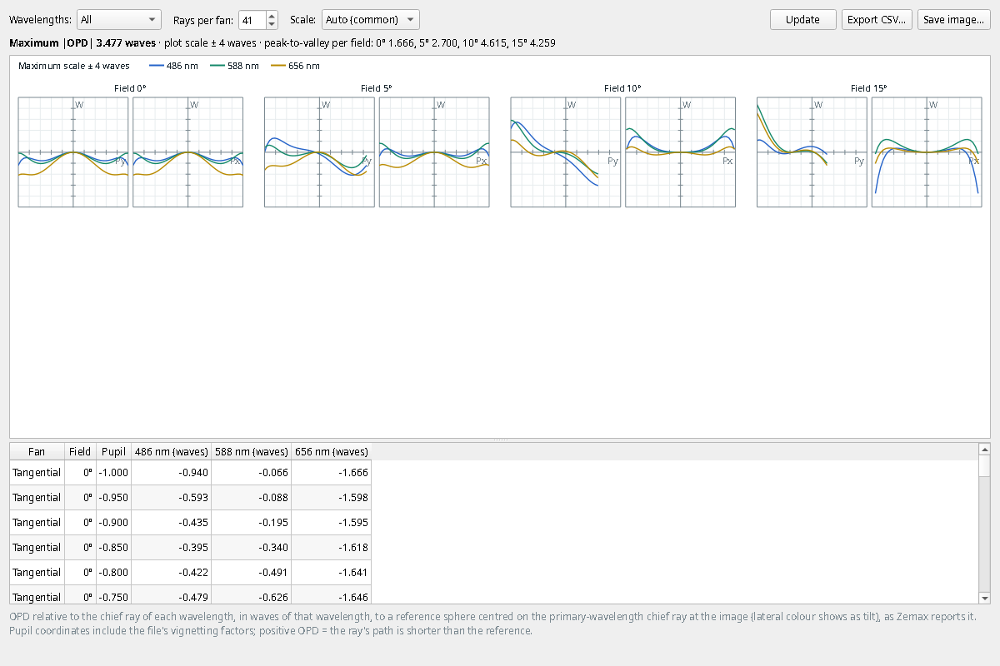

### Chromatic focal shift (Ctrl+K)

The paraxial focus at each wavelength relative to the primary wavelength, with the diffraction-limited range.

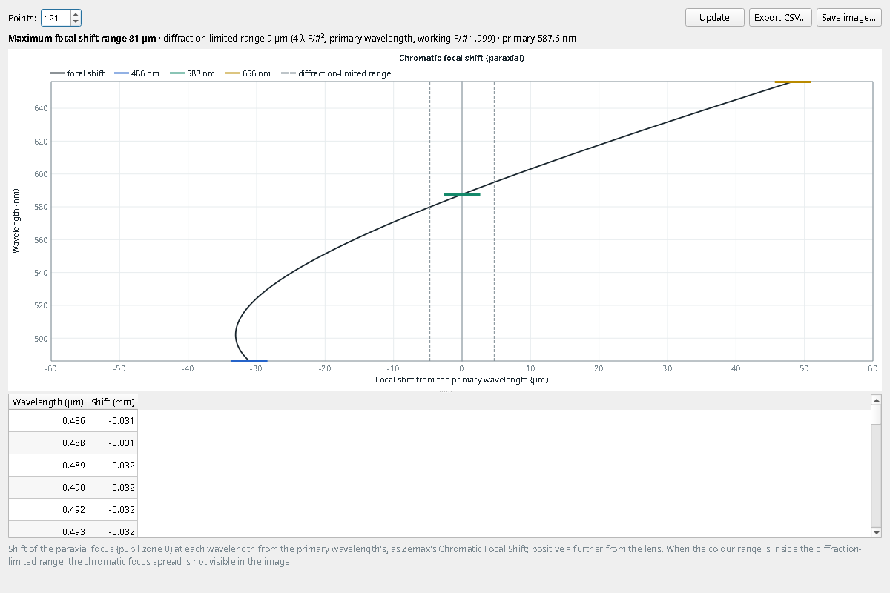

### Image simulation (Ctrl+U)

What a camera behind the lens would record: a built-in USAF 1951 chart, or any picture of yours, imaged through the
lens onto a sensor with diffraction, aberrations, distortion, relative illumination, lateral and axial colour, and
pixel averaging. The **Resolution** tab reads the finest USAF element resolved at the centre, edges and corners. Choose
the sensor (or **Custom** pixel size and count), how big the picture is in the scene, the quality, and a focus
offset. **Save image…** saves the result at full resolution.

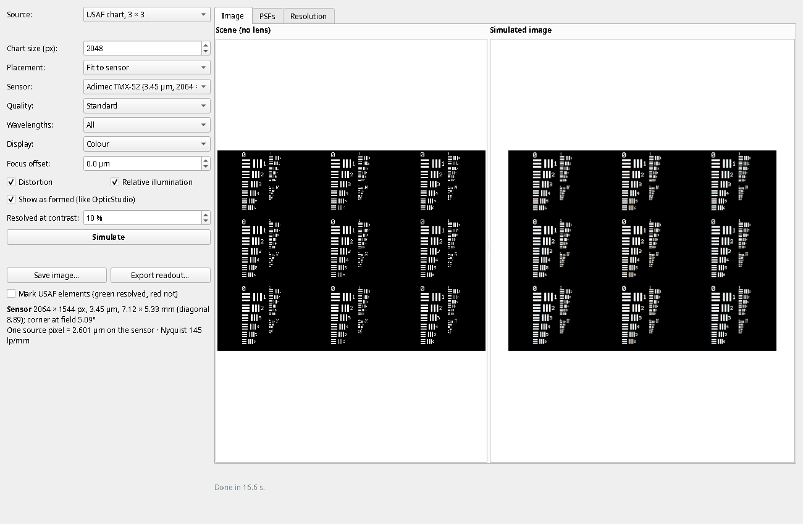

### Sensitivity (Ctrl+T)

A one-click tolerance sensitivity table. Each lens group is decentred and tilted, and each thickness changed, by ±
the amounts you set; surface form errors (irregularity, Zernike terms) can be added too. Each change is ranked by how
much it worsens the RMS wavefront, or the MTF at a chosen frequency. The image can be refocused for every change.
Double-click a row to see that change's MTF.

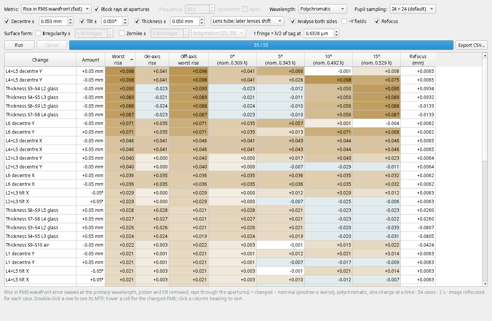

### Filter surface (Ctrl+L)

Finds the best air/glass surface for a dielectric filter coating: the one where the steepest ray meets the surface at
the smallest angle in air, over every field, wavelength and (for a zoom) configuration. Click a row to see the worst
ray on the layout.

### Refocus (Ctrl+F, or the Refocus button on the toolbar)

Best focus for the whole field, like OpticStudio's Quick Focus: the change of one air gap that gives the best image
over every field and wavelength, using the field and wavelength weights in the file.

- **Criterion:** RMS wavefront error, or RMS spot radius (about the spot centroid or the chief ray).
- **Focus moves:** the last air space, in front of any window, cover glass or filter just before the image, so they
  move with the sensor as in a real focus adjustment; or the gap just before the image, as OpticStudio does.
- The plot shows the criterion through focus for each field (dashed) and weighted over the field (bold), with the
  current and best focus marked; the table gives each field at both. Double-click a field weight to change it.
- **Apply** moves the focus for this session: every window then shows the refocused design, and the header says so.
  **Reset to file focus** undoes it. The file isn't changed.

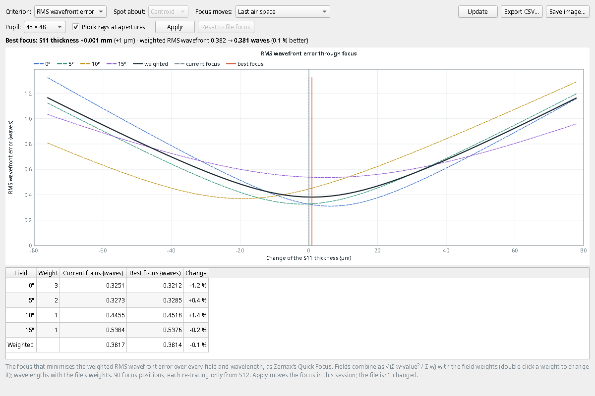

---

## Glass catalogs

The program carries the common glass catalogs (SCHOTT, OHARA, HOYA, CDGM, SUMITA, HIKARI, NHG, CORNING, infrared
materials, plastics and more, about 4,000 materials). Glasses are looked up in the order of the file's catalog list,
as OpticStudio does; the **Materials** tab shows which catalog each glass came from.

### Using your own catalogs, e.g. OpticStudio's

If you have OpticStudio, you can point the viewer at the same catalogs your designs were made with. OpticStudio keeps
them in `Documents\Zemax\Glasscat`; its Project Preferences ▸ Folders show the exact path.

The simplest way: **File ▸ Use glass catalog folder…** and choose that folder. The viewer remembers it and uses it every
time it starts. **File ▸ Use the default glass catalogs** goes back to the built-in ones.

Or start the viewer with `-g` (or `--glasscat`) and the folder, which overrides the remembered one for that start:

- **Windows:** make a shortcut to the program (right-click it ▸ **Create shortcut**), open the shortcut's
  **Properties**, and add the folder to the end of **Target**:
  ```
  "C:\Tools\sb_zmx_viewer-windows-x64.exe" -g "C:\Users\you\Documents\Zemax\Glasscat"
  ```
  Start the viewer from that shortcut from then on. The same works from a Command Prompt, and a lens file can follow:
  `sb_zmx_viewer-windows-x64.exe -g "C:\Users\you\Documents\Zemax\Glasscat" "C:\Lenses\mylens.zmx"`.
- **Linux:**
  ```
  ./sb_zmx_viewer-linux-x86_64 -g ~/Zemax/Glasscat
  ./sb_zmx_viewer-linux-x86_64 -g ~/Zemax/Glasscat mylens.zmx
  ```

The folder given is used instead of the built-in catalogs. The **System** tab shows which folder is in use, and the
**Materials** tab which catalog each glass came from.

Other ways:

- **A `Glasscat` folder next to the program** is used automatically every time, instead of the built-in set.
- **Drop an `.agf` file** onto the window to add that one catalog.
- **Catalogs inside a `.zar`** archive are used automatically for that design.

In order: the folder given with `-g`, then the folder remembered from File ▸ Use glass catalog folder…, then a
`Glasscat` folder next to the program, then one in the current folder, then the built-in catalogs. (The command-line
options of the Linux program, such as `--summary`, don't use the remembered folder, so their results don't depend on
an earlier session; give `-g` there.) Catalogs inside a `.zar`, and `.agf` files dropped on the window, come before all of these.

If a design names a catalog the program doesn't have, the notes bar says so and which catalogs its glasses were taken
from instead. Copies of a glass in different catalogs can differ slightly, so add the original `.agf` if you have it.

Glass indices follow the system temperature and pressure when the file asks for it, as OpticStudio does.

---

## What it reads

- `.zmx` lens files (old and new OpticStudio and Zemax versions) and `.zar` archives; units mm, cm, inches and metres.
- **Surfaces:** standard, even and odd asphere, paraxial (ideal) lens, paraxial XY, tilted, toroidal, Zernike fringe
  sag, Chebyshev, irregular, grid sag, binary 2 and binary 3 (diffractive), diffraction grating, hologram, gradient
  index 1 and 9, birefringent in/out.
- **Geometry:** mirrors, coordinate breaks, tilted and decentred surfaces, fold mirrors, prisms, off-axis and
  two-mirror telescopes with obscurations and spiders, tilted object and image planes.
- **Apertures:** floating, circular, obscuration, rectangular, elliptical, spider and user-defined.
- **System:** entrance pupil diameter, image-space F/#, working F/#, float by stop size, object-space NA and cone
  angle; ray aiming; vignetting factors; solves and pickups; multi-configuration operands (zooms, focus positions,
  temperature).
- **Non-sequential components inside a sequential design** (polygon-object prisms) are traced.
- **Non-sequential designs** open as a drawing only.

---

## Command line (Linux)

The Linux program also works without its window, printing results to the terminal:

```
./sb_zmx_viewer-linux-x86_64 --summary mylens.zmx                 # EFL, F/#, track, BFL, mass
./sb_zmx_viewer-linux-x86_64 --mtf mylens.zmx --mtf-freqs 10,20,50
./sb_zmx_viewer-linux-x86_64 --ri mylens.zmx                      # relative illumination
./sb_zmx_viewer-linux-x86_64 --field-curvature mylens.zmx         # CSV
./sb_zmx_viewer-linux-x86_64 --opd-fan mylens.zmx                 # CSV
./sb_zmx_viewer-linux-x86_64 --chromatic mylens.zmx               # CSV
./sb_zmx_viewer-linux-x86_64 --sens mylens.zmx                    # sensitivity table
./sb_zmx_viewer-linux-x86_64 --filter mylens.zmx                  # filter surface ranking
./sb_zmx_viewer-linux-x86_64 --image-sim mylens.zmx --sim-out sim.png
./sb_zmx_viewer-linux-x86_64 --help                               # every option
```

`--config N` picks a configuration of a multi-configuration file; `-g FOLDER` uses another glass catalog folder
(`--where-glasscat` prints which folder would be used).

---

## Limitations

- **Not modelled:** user-defined (DLL) surfaces and encrypted black boxes (rays are drawn up to them and the analyses
  are turned off; the notes say so), and non-sequential objects other than polygon prisms.
- **Temperature configurations:** thermally scaled radii and thicknesses (thermal pickups) are worked out again as
  OpticStudio does when it loads the file; a few air spaces still differ from OpticStudio's by up to about ten
  micrometres, and thermally scaled aspheric terms are taken as stored in the file.
- **Relative illumination** behind very small rectangular apertures needs a fine pupil sampling (raise it in the
  window) to settle.
- **Missing glass catalogs:** see [Glass catalogs](#glass-catalogs).
- Results agree closely with OpticStudio but aren't guaranteed to match it in every case. Check anything critical
  in OpticStudio before relying on it.

---

## Support and terms

If sb_zmx_viewer is useful in your work, please consider supporting its development at
[buymeacoffee.com/shailen001](https://buymeacoffee.com/shailen001) (also under **Help ▸ About**). More from the
author: [github.com/shailen001](https://github.com/shailen001).

The programs are provided free of charge, as is, without warranty of any kind.

Zemax and OpticStudio are trademarks of Ansys, Inc. sb_zmx_viewer is an independent program, not affiliated with or
endorsed by Ansys or Zemax.
